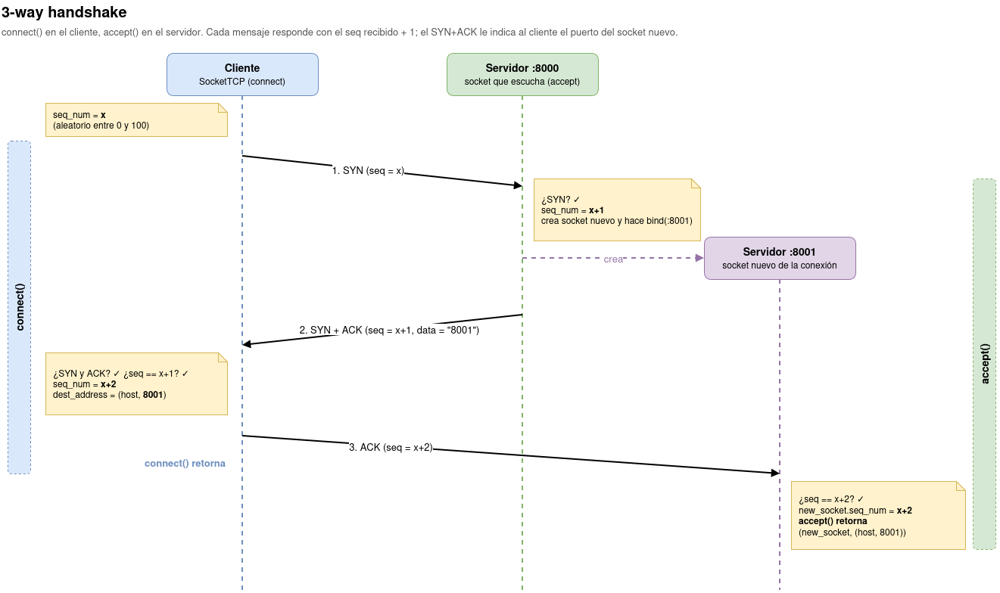
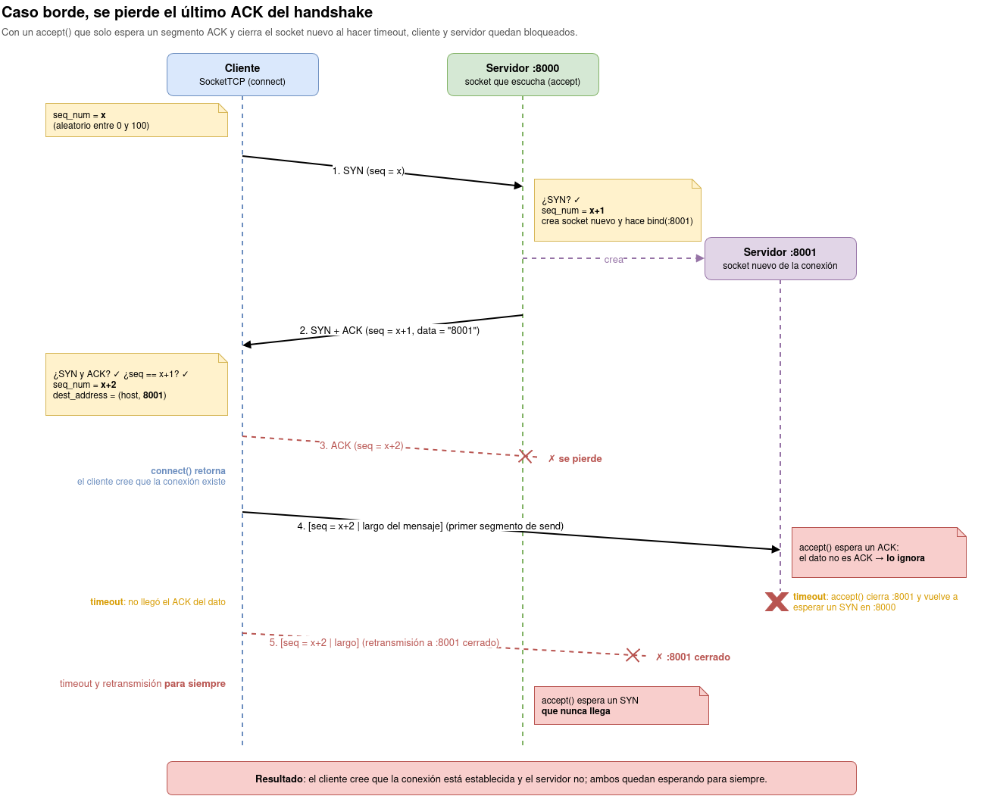

# Informe Actividad 3 - Stop & Wait
## André Guinart Carranca

Link a github: https://github.com/ACGrt/actividades-redes

Implementación de un TCP simplificado sobre sockets UDP: la clase `SocketTCP` maneja
el 3-way handshake, el envío confiable con Stop & Wait y el cierre de conexión, todo
tolerante a pérdidas.

## Archivos

| Archivo | Contenido |
|---|---|
| `SocketTCP.py` | Clase `SocketTCP`: segmentos, handshake, `send`/`recv`, cierre y modo debug |
| `cliente.py` | Cliente de entrega: envía un archivo recibido por entrada estándar y cierra la conexión |
| `server.py` | Servidor de prueba: recibe el mensaje, cierra la conexión e imprime el contenido |
| `clientTest.py`, `serverTest.py` | Tests de `send`/`recv` del material de la actividad, más el cierre |
| `test2n.py` | Test de `recv(n)` con un mensaje de `2n` bytes |

Ejecución:

    % python3 server.py localhost 8000 > recibido.txt
    % python3 cliente.py localhost 8000 < archivo.txt

Ambos aceptan `--debug` al final para activar el modo debug.

## 1. Formato del segmento

El header ocupa **7 bytes** y va al inicio del área de datos del datagrama UDP:

| Bytes | Campo | Codificación |
|---|---|---|
| 0-3 | `seq` | entero sin signo, big endian |
| 4 | `ACK` | `1` o `0` |
| 5 | `SYN` | `1` o `0` |
| 6 | `FIN` | `1` o `0` |
| 7- | datos | a lo más 16 bytes |

`parse_segment` y `create_segment` son métodos estáticos que pasan entre estos bytes y
un diccionario `{"seq", "ack", "syn", "fin", "data"}`.

**Decisiones:**

- Una primera versión usaba 1 byte para `seq`. Como el número de secuencia avanza con
  cada segmento, se desbordaba al pasar de 255 (`bytes must be in range(0, 256)`) en
  cuanto el archivo superaba unos 4 KB. Por eso usa 4 bytes.
- Un byte por flag creo que es menos compacto que usar bits, pero hace el parseo directo y el
  header sigue siendo pequeño.
- El buffer del socket UDP es fijo: `BUFFER_SIZE = HEADER_SIZE + MAX_PAYLOAD = 23`, como
  pide el enunciado. No depende del `buff_size` que recibe `recv`.

## 2. Números de secuencia

Hay **un solo contador `seq_num` por socket**, compartido entre ambos lados:

- Cada segmento enviado lleva el `seq_num` actual.
- Su ACK responde con `seq + 1`, y ambos lados avanzan su contador en 1.
- Después del handshake ambos lados quedan con `seq_num = x+2`.

El header no tiene un campo de número de ACK separado, así que devolver `seq + 1` es la
forma de indicar "esto responde a tu segmento". Como cada segmento hace avnzar los dos
contadores por igual, estos se mantienen sincronizados aunque los datos cambien de
dirección.

## 3. 3-way handshake (paso 4)

- `connect(address)` elige `x` al azar entre 0 y 100 y envía el SYN. Al recibir el
  SYN+ACK verifica que traiga `seq = x+1`, lee el puerto del socket nuevo desde los
  datos del segmento y envía el ACK con `seq = x+2` **a ese puerto nuevo**.
- `accept()` espera un SYN en el socket que escucha. Al recibirlo crea un `SocketTCP`
  nuevo, le hace `bind` al puerto siguiente (`:8001` si escucha en `:8000`) y envía el
  SYN+ACK con el número de ese puerto en los datos. Luego espera el ACK **en el socket
  nuevo** y retorna `(socket_nuevo, dirección_nueva)`.

**Decisión:** Dado que el SYN+ACK es el único mensaje que el servidor le envía al cliente durante el handshake el socket nuevo se crea **antes** de enviar dicho mensaje para informarle al cliente su puerto.

## 4. Stop & Wait: `send` y `recv` (paso 5)

### `send(message)`

1. Envía un primer segmento con el largo del mensaje, codificado como texto
   (`str(len(message)).encode()`).
2. Envía el mensaje en trozos de a lo más 16 bytes.

Cada segmento pasa por `_send_and_wait_ack(data)`, que lo retransmite en cada timeout
(fijo, 1 s, con `settimeout`) hasta recibir un ACK con `seq_num + 1`. Cualquier otro ACK,
por ejemplo un duplicado atrasado, se ignora.

### `recv(buff_size)`

Usa dos variables del constructor que se mantienen entre llamadas:

| Variable | Rol |
|---|---|
| `remaining` | bytes del mensaje actual que todavía no llegan |
| `recv_buffer` | bytes ya recibidos que todavía no se entregan |

Si `remaining == 0` y `recv_buffer` está vacío, el primer segmento que recibe es el largo
de un mensaje nuevo. Luego recibe trozos hasta tener `buff_size` bytes o hasta que
`remaining` llegue a 0, y retorna a lo más `buff_size` bytes. Así retorna apenas tiene
`min(message_length, buff_size)` bytes y se puede llamar las veces que haga falta.

**Decisión para cuando el último trozo se pasa de `buff_size`:** los bytes que sobran
quedan en `recv_buffer` y se entregan primero en la siguiente llamada, sin esperar un
largo nuevo. Por ejemplo, con `buff_size = 20` y trozos de 16 bytes, la primera llamada
recibe 32 bytes, entrega 20 y guarda 12.

Cada segmento se recibe con `_recv_segment()`:

- Si llega el `seq` esperado, envía su ACK, avanza `seq_num` y entrega los datos.
- Si llega un `seq` menor, es un duplicado: su ACK se perdió y el emisor lo
  retransmitió. Se vuelve a enviar el ACK y los datos se descartan.
- Los segmentos ACK se ignoran, para que un ACK duplicado y atrasado no se interprete
  como datos.

## 5. Cierre de conexión (pasos 6 y 8)

**`close()`:**

- Envía el FIN y espera el FIN+ACK. Cada timeout reenvía el FIN. Después del tercer
  timeout asume que la contraparte cerró.
- Al recibir el FIN+ACK, envía el ACK final **3 veces**, esperando un timeout entre cada
  envío.

**`recv_close()`:**

1. Espera el FIN **sin límite de tiempo**, porque la contraparte puede tardar en llamar
   a `close()`. Mientras tanto, si llega un dato duplicado, vuelve a enviar su ACK.
2. Responde con el FIN+ACK.
3. Espera el ACK final hasta 3 timeouts. Si llega el FIN otra vez (se perdió el
   FIN+ACK), reenvía el FIN+ACK.

**Decisiones:**

- La espera entre los 3 ACK finales se hace con `recvfrom` y el timeout del socket.
  Así se usa el mismo mecanismo que el resto de la clase, y si
  llega algo durante la espera, el siguiente ACK sale de inmediato.
- Reenviar el ACK de los datos duplicados en `recv_close` es necesario: si se pierde el
  ACK del último dato, el emisor nunca termina `send` y no llega a llamar a `close()`.

## 6. Caso borde: se pierde el último ACK del handshake (paso 7)

Si se pierde el ACK final, `connect()` retorna igual: el cliente cree que la conexión
existe y empieza a enviar datos al puerto nuevo. Con un `accept()` que solo espera un
segmento ACK y cierra el socket nuevo al hacer timeout, el servidor descarta esos datos,
cierra `:8001` y vuelve a esperar un SYN. El cliente retransmite para siempre a un
puerto cerrado y el servidor espera un SYN que no llega nunc.

**Solución:**

- **El ACK se espera en el socket nuevo.** `connect()` envía el ACK al puerto nuevo, y
  `accept()` lo espera ahí.
-  El primer segmento de datos de `send()` lleva el **mismo `seq`
  (`x+2`)** que el ACK perdido. Por eso `accept()` acepta cualquier segmento con
  `seq = x+2` que no sea SYN, sea el ACK o el primer dato, como confirmación del
  handshake.
  - Si fue un dato, `accept()` lo consume, pero no se pierde: el cliente nunca recibió
    el ACK de ese dato, así que lo retransmite y `recv()` lo procesa normalmente.
- Si `accept()` hace timeout, reenvía el SYN+ACK en vez de cerrar el socket nuevo.
  Esto cubre también la pérdida del SYN+ACK. Si se pierde el SYN, `connect()` lo reenvía
  en cada timeout.

## 7. Modo debug

Se activa con `--debug` en `cliente.py` y `server.py`, o con `SocketTCP.DEBUG = True`.
Los mensajes van a stderr, para no mezclarse con el contenido que el servidor imprime en
stdout. Muestra cada evento de manejo de pérdidas:

| Mensaje | Significado |
|---|---|
| `connect: timeout waiting for SYN-ACK, resending SYN` | se perdió el SYN o el SYN+ACK |
| `accept: timeout waiting for ACK, resending SYN-ACK` | se perdió el SYN+ACK o el ACK |
| `accept: handshake ACK lost, data segment taken as implicit ACK` | caso borde del paso 7 |
| `send: timeout waiting for ACK of seq=N, retransmitting` | se perdió el dato o su ACK |
| `recv: duplicate segment seq=N (its ACK was lost), resending ACK` | se perdió el ACK de ese dato |
| `close: timeout waiting for FIN+ACK (k/3), resending FIN` | se perdió el FIN o el FIN+ACK |
| `close: sending final ACK (k/3)` | los 3 envíos del ACK final |
| `recv_close: FIN received again (FIN+ACK was lost), resending FIN+ACK` | se perdió el FIN+ACK |
| `recv_close: timeout waiting for final ACK (k/3)` | se perdió el ACK final |

## 8. Pruebas

### 8.1. Tests de `send`/`recv` y cierre, sin pérdidas

`serverTest.py` y `clientTest.py` contienen los tests del material de la actividad, más
`close()` y `recv_close()` al final:

    Test 1: Passed      (buff_size = 16, mensaje de 16 bytes)
    Test 2: Passed      (buff_size = 19, mensaje de 19 bytes)
    Test 3: Passed      (buff_size = 14, mensaje de 19 bytes en dos llamadas)
    Close: Passed

### 8.2. Envío de un archivo con pérdidas (netem)

    % sudo tc qdisc add dev lo root netem loss 20%
    % python3 server.py localhost 8000 --debug > recibido.txt
    % python3 cliente.py localhost 8000 --debug < archivo.txt
    % cmp archivo.txt recibido.txt && echo "idénticos"
    idénticos

En `lo` la pérdida afecta las dos direcciones. El archivo de 1341 bytes llegó íntegro.
Hubo 49 retransmisiones del cliente y 24 duplicados detectados por el servidor.
Extractos del modo debug:

**Handshake con el SYN+ACK perdido.** Ambos lados hacen timeout y el SYN+ACK reenviado
sí llega:

    [cliente]  connect: timeout waiting for SYN-ACK, resending SYN
    [servidor] accept: SYN received (seq=30)
    [servidor] accept: timeout waiting for ACK, resending SYN-ACK
    [ambos]    connection established ... port 8001

**Pérdida de un ACK** (`seq=34`). El servidor sí recibió el dato, por eso lo detecta como
duplicado y reenvía el ACK:

    [cliente]  send: timeout waiting for ACK of seq=34, retransmitting
    [servidor] recv: duplicate segment seq=34 (its ACK was lost), resending ACK

**Pérdida del dato** (`seq=35`). Hay dos retransmisiones y el servidor no reporta
duplicados, así que el segmento de datos se perdió dos veces antes de llegar:

    [cliente]  send: timeout waiting for ACK of seq=35, retransmitting
    [cliente]  send: timeout waiting for ACK of seq=35, retransmitting

**Cierre con el FIN perdido:**

    [cliente]  close: timeout waiting for FIN+ACK (1/3), resending FIN
    [cliente]  close: sending final ACK (1/3)
    [cliente]  close: sending final ACK (2/3)
    [cliente]  close: sending final ACK (3/3)

### 8.3. `recv(buff_size)` con `buff_size < message_length`

`test2n.py` envía un mensaje de `2n` bytes y llama 2 veces a `recv(n)`, con `n` que no
es múltiplo de 16 (por defecto 7, 25 y 37; se pueden pasar otros como argumentos):

    % python3 test2n.py

Se corrió sin pérdidas y con `netem loss 20%`:

| `n` | Mensaje | Sin pérdidas | netem `loss 20%` |
|---|---|---|---|
| 7 | 14 bytes | 7 + 7 bytes, Passed | 7 + 7 bytes, Passed |
| 25 | 50 bytes | 25 + 25 bytes, Passed | 25 + 25 bytes, Passed |
| 37 | 74 bytes | 37 + 37 bytes, Passed | 37 + 37 bytes, Passed |

Con `n = 25`, la primera llamada recibe 2 trozos (32 bytes), entrega 25 y guarda 7 en
`recv_buffer`. La segunda entrega esos 7 más los 18 restantes.

## 9. Casos borde encontrados y limitaciones

- **Dato duplicado mientras se espera un ACK.** Si se pierde el ACK del último dato y el
  receptor pasa a enviar, ambos lados quedaban esperando un ACK que el otro nunca
  enviaba. `_send_and_wait_ack` ahora reenvía el ACK de los datos duplicados.
- **ACK atrasado interpretado como dato.** Un ACK duplicado con el `seq` esperado se
  tomaba como datos vacíos, y si se esperaba el largo, `int(b"")` fallaba.
  `_recv_segment` ahora ignora los segmentos ACK.
- **SYN duplicado sin leer.** Si se pierde el SYN+ACK, el SYN reenviado queda en el
  buffer del socket que escucha. Con una sola conexión no afecta, pero una segunda
  llamada a `accept()` leería ese SYN viejo.
- **Puerto nuevo fijo.** El socket de la conexión usa el puerto siguiente al que
  escucha, así que se atiende una conexión a la vez.
- **El último ACK del cierre no se puede garantizar.** Si se pierden los 3 envíos,
  `recv_close()` cierra igual después de 3 timeouts. Es lo esperado según el enunciado.
- **`accept()` y `recv_close()` esperan sin límite** el SYN, el ACK del handshake o el
  FIN. Si la contraparte desaparece, quedan bloqueados.
